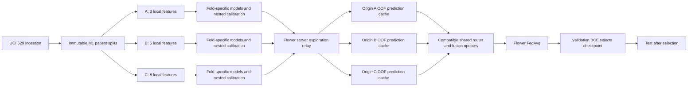
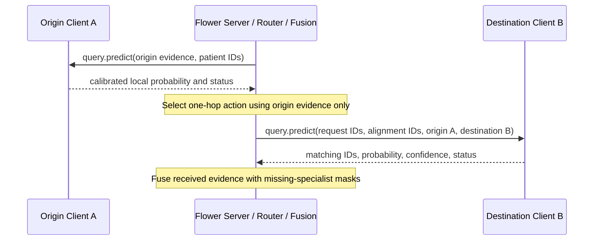
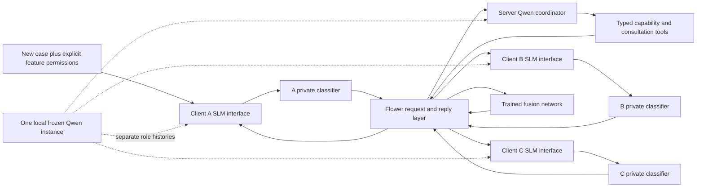
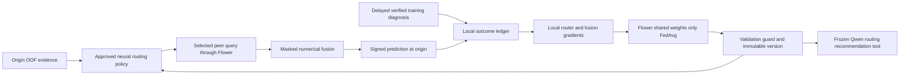

# Implemented architecture

## Documentation site

Read the Docs builds the Sphinx site from `docs/` on Ubuntu 24.04 with Python
3.11. MyST renders the existing Markdown architecture, research, status, and
limitations sources. PyData Sphinx Theme provides grouped navigation, search,
the purple project favicon, a persistent collapsible sidebar, and a dark-first
responsive layout; Copybutton provides copyable examples. Autodoc reads the public
`fed_med_agents` exports with runtime dependencies mocked, so the docs environment
does not install the package or its Flower, Ray, PyTorch, NumPy, and Pydantic
runtime stack.

## Step 8B release surface

Stable `0.1.0` preparation preserves the `src/fed_med_agents` package and every
runtime component. Release promotion changes package/version metadata and public
documentation only; it does not change collaboration protocols or model behavior.

The PyPI release path is a two-job GitHub Actions pipeline triggered only by a
pushed `v*` tag. The unprivileged build job checks out that tagged commit,
requires an exact `v<pyproject version>` match, builds one wheel and one sdist,
runs strict Twine validation, checks the expected filenames, and uploads a
SHA-named short-lived Actions artifact. The dependent publishing job downloads
only that artifact from the same workflow run. Only the publishing job has
`id-token: write`, and it is bound to the protected `pypi` environment before
`pypa/gh-action-pypi-publish@release/v1` exchanges GitHub OIDC identity with PyPI.
There is no branch, pull-request, or manual-dispatch publication path.

The distribution is `swarmfl`; imports remain `fed_med_agents`. Root re-exports
cover registry/session, routing, fusion, feedback, and version APIs. The packaged
CPU quickstart is a disease-neutral synthetic Flower app with three local NumPy
models and explicit declarations.

Logical registration and physical federation are separate. A declaration does not
load a checkpoint, start a service, or join Flower. Consultation requires a live
node binding and checks schema, capability, availability, cost, and permissions.
New-case fields are filtered to the selected recipient; fusion consumes only
observed evidence. The demo uses Flower 1.40.0 typed messages and starts no service
on import.

## M5 Step 8A: external integration validation

The existing architecture is validated end to end without a new core abstraction:
private specialist -> SpecialistRegistry/ConsultationSession -> RoutingPolicy ->
selected Flower query -> DynamicFusion -> signed PredictionEvent/VerifiedOutcome
-> ContinualController -> compatible router/fusion FedAvg -> PolicyPair gates and
atomic activation/rollback. `tests/support/validate_step08a.py` is deliberately outside
the package and acts as an external developer integration.

Three independently fitted sklearn checkpoints expose explicit task, output,
feature, adapter, version, alignment, cost and SHA256 declarations. The public
registry accepts heterogeneous model families because execution remains behind an
application-owned adapter. Aligned consultation transmits opaque case IDs and
contract metadata only. New-patient consultation filters a caller-provided record
to the selected recipient's authorized required fields before Flower dispatch.
The receiver rechecks task, recipient, adapter, checkpoint, field schema, values
and alignment before loading its private model.

The genuine three-node CPU simulation discovers declarations from ClientApps and
keeps logical registry lifecycle separate from physical nodes. Router preparation
happens locally; the server groups only selected patient IDs by recipient and sends
one batch per actual origin-recipient edge. Fusion receives origin plus observed
selected evidence only. A timeout consumes the attempted session budget and does
not trigger another recipient. Application byte counts exclude transport framing;
listener inspection covers the simulation process tree and observed loopback-only
bindings, not firewall or remote-host guarantees.

Each component has one FedAvg round with two local epochs. Clients authenticate
fresh signed feedback, train only compatible shared arrays, and commit request IDs
after successful aggregation. Validation labels are first opened after both
candidates freeze. Router gates compare incumbent and fixed control; fusion gates
compare incumbent and matched mean on identical actions. Compatible eligible
versions can activate together; retained versions permit exact rollback. External
CDC shared checkpoints are loaded through their explicit metadata and rejected
when paired with synthetic identities. No CDC private or frozen-test data enters
this workflow, and no framework core source changed in Step 8A.

Public CI treats those retained Step 7 shared checkpoints as optional historical
evidence. Their compatibility test runs with all original assertions when both
checkpoint files are present and skips explicitly otherwise. The disease-neutral
synthetic lifecycle test is independent and always exercises rejection, approval,
restart recovery, and exact rollback in public CI.

## M5 Step 7: continual orchestration and compatible pair activation

`feedback/continual.py` reuses M4 FeedbackLedger/PredictionEvent/VerifiedOutcome,
Step 5 RoutingPolicy and Step 6 DynamicFusion. The reusable controller accepts an
origin-local authorized pre-query context and a ConsultationSession. It routes,
requests only selected evidence through the transport callback, applies dynamic
fusion and logs a signed outcome-free M4 prediction. prepare/finish supports
selected-only batching without exposing raw local context. An in-flight request
fails closed if its active pair changes; dispatch rechecks registry availability,
permissions, schema and budgets. No unqueried prediction enters feedback records.

Legacy signed-event schemas/digests are unchanged. A signed local RequestSnapshot
sidecar binds the original prediction digest to immutable identity order, private
checkpoint hashes, fusion metadata contract, pair versions and origin-only context.
Sidecars are written atomically before the ledger prediction; a crash may leave
an orphan that is not trainable. Recovery reauthenticates all completed predictions
and local consumption state; tampering/missing context fails closed. The M4 ledger
checks outcome signer/authority, patient/request/digest and delayed episode/time.
The controller rejects repeated patient-origin feedback; pending missing outcomes
never acquire a label. Outcomes are not verified by the prediction model.

pending(component,cutoff) returns fresh verified records only. train_local enables
router/fusion independently and optionally loads compatible Flower state. Router
uses its existing observed-only IPS surrogate. Fusion feedback BCE is added to
feedback/learning.py and uses only logged origin/consulted probabilities and labels,
identity metadata and masks. Private experts/calibrators and reliability estimates
stay frozen. Singleton residual gradient is zero; mean/weighted and fixed baselines
do not train. commit(component,request_ids) records successful use once per path;
rejected validation candidates also consume fitting records. Validation patients
are explicitly outside the ledger allowlist. Training/validation roles are kept
by the application adapter, not inferred from raw clinical IDs by the controller.

feedback/versions.py adds PolicyPair over separate existing PolicyRegistry stores.
A single atomic active.json replacement switches the compatible pair after both
component and joint validation; inference reads one complete pair. Eligible flags
are trusted gate results, not a separate clinical authority. The controller never
uses independent legacy approved.json pointers. Activation preserves router ID
order/context width and exact fusion task/output/feature/checkpoint bindings;
unknown deployment changes require explicit migration. Retained earlier versions
support exact rollback. Transition records precede activation; interrupted entries
may remain uncommitted, and the active pointer is authoritative. Single writer,
local atomic replacement only: no cross-process lock, distributed consensus,
fsync power-loss guarantee or exactly-once recovery of a mid-FedAvg round.

experiments/cdc_continual.py is the fixed CDC adapter and real Flower study. Three
label-independent group-complete feedback batches come from Step 5 fold0 guard;
three disjoint validation batches come from its assessment. Both exclude initial
expert/router/fusion fitting groups. Historical development selection/evaluations
have used these source partitions, so this is not pristine external evidence.
Synthetic request episodes 1/3/5, outcomes 2/4/6 establish the simulated chronology.
Every tenth outcome remains missing. Local clients generate authorized own fields
and frozen private predictions, and only selected-peer batches trigger Flower
consultation. Validation may read frozen full-information caches diagnostically;
those unchosen outcomes never enter feedback training. Cycle2 masks B for A/C
requests while retaining B's own-origin service. Physical membership stays at 3.

One genuine FedAvg round per component per cycle gives6 aggregates/18 local updates.
Clients train from signed fresh replay, send shared arrays/scalar loss only, then
commit local consumption after successful aggregation. Independent router gates
compare previous/fixed routing with the current fusion. Fusion gates use the
previous router's identical evidence and compare previous/mean fusion. A joint
matched-population objective/safety gate checks the proposed combination before
atomic activation. Rejected components retain their previous version. Control
fixtures test approvals and rollback independently from scientific success.

## M5 Step 6: variable-cardinality fusion

`fusion/dynamic.py` separates binary-risk set fusion from CDC configuration.
`FusionEvidence` binds actual observed probability, stable specialist/case IDs and
checkpoint hash. `DynamicFusion.fuse()` validates current registry membership,
availability, authorization, task/output/feature/adapter bindings and alignment.
Missing/unconsulted peers are absent, never imputed. Unavailable/stale evidence is
rejected. Mandatory origin evidence gives exact singleton/STOP fallback. Fusion
has no transport calls, additional inference or consultation budget side effects.

Mean averages raw probabilities. Weighted mean estimates exp(-BCE) from training
OOF predictions and normalizes stably over the actual subset. Set fusion uses
11-wide tokens: logit/confidence/origin flag, 6 deterministic SHA256 identity
coordinates, log1p(input width)/5 and fitting-only reliability. Shared 11->16->16
encoding, mean pooling and count/base-logit metadata feed an 18->16->1 residual
head. No count-dependent learned embedding or fixed slots are used. Masked padded
values are removed before encoding/pooling. Public inference canonicalizes IDs;
tensor permutation invariance holds within float32 reduction tolerance. Exact
probability endpoints are preserved by public mean/singleton rules; finite tensor
logit math clamps endpoints. New identities require explicit validated contracts;
fixed network dimensions do not prove unseen-model generalization.

M4 `PolicyRegistry` gains an explicit `fusion_config` factory branch; ambiguous
router/fusion metadata is rejected. Historical combined and routing-only versions
retain their architecture. Dynamic checkpoints store strategy, contracts and state.
Flower clients compare canonical contract fingerprints before accepting shared
arrays. Capability sets are sorted during serialization. Only new set-fusion
weights are averaged, never private heterogeneous experts or routing parameters.
Research validation/approval does not replace production defaults.

`experiments/cdc_fusion.py` reuses Step 5 fold0 final private experts/calibration and
OOF caches. Training 162,850, guard 20,154 and assessment 19,815 rows have duplicate-
group-disjoint held boundaries. OOF training predictions exclude each row from its
expert/calibrator. New fusion fits all 12 subset/origin combinations containing the
origin; old residual60 was trained on 9 STOP/one-peer masks. Its fullABC comparison
is outside trained mask support. No held label fits reliability/fusion, and no
specialist/router is refitted. Existing residual/logistic/masked mean APIs and
saved dense checkpoint semantics remain untouched.

The real Flower App reuses Step 4 capabilities and recipient-validated private
inference. Discover 3 declarations, register AB, add C, disable/restore B, remove C;
only explicitly selected peers are queried. Origin uses separate origin-local
inference. FedAvg runs3 rounds with 2 local epochs and origin-specific subset
objectives over the same aligned OOF training cohort. Three physical simulation
nodes remain connected, served by one CPU Ray actor. Private rows, classifier
weights and labels are absent from consultation/update payloads; trusted local
prediction caches and labels remain accessible to their simulation handlers.
No filesystem isolation, secure aggregation or privacy proof is claimed.

## M5 Step 5: routing-only trainable policies

`routing/policy.py` owns a disease-independent `RoutingPolicy` with immutable
specialist-ID ordering. Fixed origin/peer mean utility, a 32-Tanh scalar utility
MLP and the existing `ContextualRouter` graph action network share fit/predict,
observed-update and serialization interfaces. Fixed/MLP scores are predicted gross
BCE gains minus current consultation cost; STOP is zero. The graph produces action
preferences, not utility estimates; its wrapper subtracts cost/0.1 in action-logit
space and uses frozen-action expected loss for supervised fitting. Graph utility
R² is therefore not reported. Training uses only OOF targets; inference receives
own prediction, authorized own context and public metadata. Registry discovery
order never changes saved slots. Live eligibility and cost budgets constrain
`route()`; `ConsultationSession.consult()` checks them again before dispatch.
A RoutingDecision admission snapshot does not reserve a future consultation.

M4 `feedback/events.py` signs predictions and verifies request-bound delayed
outcomes, rejecting duplicates/future/pending feedback during replay.
`feedback/learning.routing_feedback_loss` consumes selected evidence/risk, actual
propensity and a local prospective context snapshot. It trains routing parameters
only with a clipped IPS policy-gradient surrogate. It never reconstructs unchosen
rewards and does not train fusion/private classifiers. `RoutingPolicy.update`
retains exact state when feedback is insufficient or the policy is fixed.
`feedback/versions.py` reuses immutable checkpoints, integrity checks, approved
pointer and rollback; optional router configuration selects a routing-only model,
while metadata without it loads the original M4 CollaborativeModel. Validation
gates compare the previous policy and matched fixed baseline before eligibility.
Approval metadata is a trusted application decision, not an external authority.

`experiments/cdc_scaling.py` is the fixed A/B/C development adapter and evidence
runner, not a production default. Fresh grouped upstream expert/calibrator fits
are required for the new split boundaries. Each of three repeated group-held
splits has validation/assessment excluded from all fitting. Three target folds
exclude each target from the entire upstream expert/calibration/fusion stack;
internal three-fold private OOF predictions train fusion. A common upstream pool
per split supplies identical target/final evidence across nested router training
prefixes. This measures routing-label sample efficiency, not total pipeline data
budget. The residual fusion schedule is fixed before assessment; there is no
assessment model selection. Original disease configuration and historical helper
defaults remain compatible; `cdc_data.prepare_stack` now optionally accepts domains.

The real feedback App reuses CDC capabilities/private inference handlers with an
explicit target-fold checkpoint binding. Origin handlers route locally, then the
server requests only selected peer probabilities and returns them for origin-local
fusion/logging. Signed training diagnoses are read locally after action selection;
only compatible routing arrays/scalars go through three genuine FedAvg rounds.
Registry outage snapshots are refreshed for each request. All three physical nodes
remain connected; no physical dynamic membership is implemented. Upstream caches
and pooled validation are trusted-local diagnostics, not filesystem isolation.

## M5 Step 4: logical specialist registry

`collaboration/registry.py` is disease-independent. Immutable closed Pydantic
declarations bind specialist ID, local adapter/checkpoint hash, ordered feature
schema/input width, binary-probability output, exact task/label meanings,
capabilities, availability and cost. `SpecialistRegistry.register/unregister/get/
discover/update/validate/eligible` maintain in-memory logical membership and
immutable snapshots with generations. Duplicate IDs/node bindings and incompatible
task/output/family/shared-feature definitions are rejected. Adapter implementation
and private weights stay behind the local recipient handler; the registry stores
their descriptor, not a Python model object or filesystem path.

`ConsultationSession` resolves current membership on every dispatch, checks feature
permissions/availability/alignment, rejects self/unavailable/unauthorized peers,
reserves remaining call/cost budgets, and checks recipient/adapter/checkpoint/case
association and bounded finite prediction output. Unexpected response fields are
rejected. A new-patient dictionary is distinct from aligned lookup and is filtered
to that recipient's required authorized fields only. CDC advertises aligned-only
inference, so its requests cannot carry raw feature values. Permission metadata
is trusted, not signed deployed consent. Rejections consume no budget; transport
attempts do, even if their reply fails. Session budgets are not persistent quotas.

`experiments/cdc_flower.py` supplies capabilities discovery and recipient-side
schema/identity/feature-map checks around the existing private CDC adapter. The
current coordinator resolves selected recipients through registered node bindings.
Its inference-only `--registry-demo` uses exactly the saved A/B/C classifiers,
residual fusion, graph router and fixed-value training summary, with zero training.
Capabilities come from each actual Flower node and are checked against saved
provenance. The fixed fusion slot mapping is a checkpoint contract, not a list of
currently registered agents. Removed/disabled specialists are masked/rejected,
never silently mapped into another model slot. New compatible binary tasks can
use separate registry contracts; arbitrary fusion dimensionality is not added.

The lifecycle demonstration registers two logical entries then a third, disables/
restores a peer and removes/re-registers another while all three physical Flower
nodes remain running. One CPU Ray actor serves them; no physical dynamic join/
leave, distributed registry persistence, hot model replacement or new training is
claimed. Historical benchmark handlers/Apps remain distinct; direct transport
access is trusted and not an authenticated external service. Existing models,
UCI529 and historical evaluation artifacts remain preserved. Step 4 is architecture
work only; detailed runtime/QA evidence is under artifacts/m5-step04-v1.

## Step 3.6 fixed-three context experiment

`experiments/cdc_context.py` is a separate CDC-only diagnostic. It reuses unchanged
private upstream fits, target-fold boundaries, CDCFusion and graph helpers. Cold
residual/logistic fits at15/60epochs use matched masks/batches; inner-only uniform
BCE selects the frozen outer fusion. Utility targets still cross-fit the entire
upstream specialist/calibration/fusion stack. No production/default change.

Pre-query metadata37 is extended with the origin's authorized13-field-padded
values and13presence flags (63inputs); every other domain field is zero and
rejected if nonzero. Fit-only scaling, ridge and32Tanh gain/rank models see no
candidate probabilities or labels in inference. Pairwise ranking and expected-gain
heads are trained on whole-stack OOF gains; known cost/eligibility are applied
before any peer consultation and STOP remains available. Separate logged bandit
training samples/persists one action before looking up its risk/diagnosis, then
fits selected-loss IPS regression only. Unselected rewards never enter its loss.
The four global action heads mask self, giving at most3valid actions/origin.

Separate Flower Apps train compatible63→32Tanh→1 shared arrays across3clients.
Origin-local query.route computes actions using its private permitted fields;
query.consult receives selected aligned IDs and returns actual private numeric
predictions. No raw feature rows/private classifier weights travel in those
queries or updates. Trusted centralized preparation and the pooled diagnostic can
read local files, so this is not secure filesystem isolation or a privacy proof.
Independent verification replays fusion outcomes, metrics, sampled feedback,
observed-only optimizer fits, every local/global update and selected predictions.
Detailed evidence lives under artifacts/m5-step036-v1; no registry or Step4.

## Current CDC three-specialist amendment

`experiments/cdc_three.py` imports the explicit user-selected `THREE_DOMAINS` and
old slot mapping `(1,3,4)` from cdc_data. It copies compatible private OOF/final
model files and provenance, remaps aligned probability/reliability columns, and
reuses exact old data/context boundaries. It creates every target-fold/final
three-agent fusion from a saved cold seed, then calls the existing nested routing
helpers with the explicit three-domain configuration. No shared weight slicing
or warm start; all private files stay unchanged. No specialist registry.

`cdc_routing` infers compatible numerical dimensions for fusion/metrics and accepts
explicit domain metadata for pre-query design; original six-client defaults remain
reproducible. Service schedules map old origin/candidate slots, preserving public
coverage and prices for the retained specialists. Numeric gate thresholds remain
unchanged, including the requirement that at least three origins vary peers.
Three-agent dimensions: base12/enriched37, fusion original12→24→1/logistic6→1,
graph3×3 plus11→16→4 context, numeric value MLP37→32→1 for Flower.

`cdc_flower` recognizes only the historical-six and explicit amended-three CDC
profiles. Current default output is three-agent; actual num_supernodes/minimum
training nodes are three, all three clients reply in each real FedAvg round.
Only compatible router arrays/scalars travel in updates; aligned-ID consultation
handlers return selected private predictions. One CPU actor, no generalized
federation/Qwen/serving claim. `verify_m5_step035 --report` supports independent
read-only historical replay into a new summary path, preserving original evidence.
The new report script writes separate amendment reports/CSV. No old reports,
UCI529 models, datasets or approved pointers are modified.

## M5 Step 3.5 fixed-six CDC benchmark

`experiments/cdc_data.py` owns UCI891 schema/domain configuration, label-independent
identical-feature grouping, frozen test/development separation, group-safe
histogram classifiers and independent sigmoid calibration. It does not change
the existing UCI529 pipeline or package identity. Six legitimate overlapping
domains represent simulated aligned feature heterogeneity, not hospitals.

`m5_step035.py` performs nested development-only size controls, whole-upstream
utility cross-fitting, inner-only selection and preregistered scale gates.
`cdc_routing.py` is the fixed benchmark adapter: it reuses original six-client
PredictionFusion/ContextualRouter where compatible, a numeric masked-logit/mean
condition, and ridge/MLP values. No registry/generalized fusion architecture is
introduced. Own calibrated p and public/train-derived metadata are the only
prospective inputs. Domain outages affect eligibility, never classifier inputs
or weights; recorded service schedules are outcome-independent.

`cdc_flower.py` supplies separate six-client ClientApp/ServerApp/FedAvg handlers,
compatible routing-only updates, full-information numeric evidence queries and
selected-only aligned-ID consultations. One CPU Ray actor, three rounds/two local
epochs, paired six-epoch pooled central diagnostic. It is a benchmark compatibility
check, not a generalized federation/serving implementation or a Qwen adapter.
Private experts and frozen fusion are outside aggregated arrays. All full pipeline
preparation remains trusted-local. Public metadata/scores/updates can disclose
information; no formal privacy is inferred.

`scripts/verify_m5_step035.py` independently checks group/upstream exclusions,
private probabilities, frozen fusion outcomes, routing metrics/actions and every
Flower local/global update. Report generation writes full CSV/diversity records
and [reports](experiments/m5-step035-benchmark.md). No default pointer changes;
the failed scale gate stops before50k or dynamic registry work.

## M5 Step 3 routing-only experiment

`experiments/m5_step03.py` builds new nested original-training-only contexts.
Each target fold gets an independent restricted specialist OOF/final pipeline
AND uniform-action fusion fit; target patients are excluded from all upstream
labels/calibration/preprocessing. Full-context fusion is separately fitted and
frozen. `consultation_value.py` implements pre-query feature construction, small
shared gain regressors, cost/budget/availability checks and retrospective metrics.
Inputs are own calibrated probability plus permitted public/train-derived
statistics; labels and peer evidence exist only in offline target construction
and post-decision diagnostics. No raw feature summary is added or transmitted.

`value_federation.py` uses separate Flower ClientApp/ServerApp/FedAvg handlers.
It queries/validates full offline probability evidence, trains only shared routing
parameters from origin-local examples, and exercises real aligned-ID selected
consultations before masked frozen fusion. Central nested preparation is explicitly
a trusted diagnostic, not federation. All private/fusion states and historical
checkpoints remain outside aggregated arrays. Five rounds/16 local steps are
compared with the same neural architecture's 80 pooled central steps; optimizer
schedules differ. At most one worker uses GPU resources; actual training used CPU.

Ridge/tree/MLP experimental states and existing fixed logistic class do not replace
production graph/fusion or M3/M4 registries. Inner-only selection and numerical
gates are frozen in [protocol](experiments/m5-step03-protocol.md); no promotion.
Independent verification/reporting live in scripts/verify_m5_step03.py and
scripts/report_m5_step03.py. Full information is disclosed during diagnostic
training; selected-only deployed checks are separate. Neither proves privacy.

## M5 Step 2 experimental boundary

`experiments/repair_data.py` constructs train-only nested fitting/selection/
assessment contexts, refitting original specialist classifiers, age scaling,
inner calibration and OOF predictions. `repair_models.py` contains fixed three-
client experimental original/slim/logistic fusion, uniform pretraining, gain
regression and pre-query decisions. This is not a generalized fusion registry.

`experiments/m5_step02.py` defines separate current Flower ClientApp/ServerApp
handlers. Three compatible clients return shared arrays/scalars; installed FedAvg
or FedProx aggregates them. FedProx supplies proximal-mu, with the standard client
distance penalty. Persistent Adam keeps moments local to an origin/context/variant
while accepting new global parameters. Every local and global state is retained.
Central pooled/interleaved training is explicitly diagnostic, not federation.

Candidates are fixed before outer assessment. Selection reads only the inner
selection objective. The original default model and M3/M4 serving pointers are
untouched; logistic/slim checkpoints require their own experimental classes.
The marginal policy regresses training-only realized gains with frozen pretrained
fusion; deployment receives only own probability/confidence, identity and public
availability. Utility bins are a deterministic fitting-only control. All methods
mask absent evidence and enforce maximum one non-self peer.

`repair_feedback.py` reuses the existing M4 Apps unmodified, changing local replay
step count only on new training-only data/guard contexts. It audits authenticated
observed outcomes at every actual local optimizer step; it never fabricates
unqueried outcomes. Raw feature/private-parameter files remain simulator-local;
prediction/gradient disclosures still give no privacy guarantee. Verification and
reporting are in scripts/verify_m5_step02.py and scripts/report_m5_step02.py.
See the [preregistered protocol](experiments/m5-step02-protocol.md).

## M5 Step 1 diagnostic workflow

`experiments/m5_step01.py` defines separate Flower ClientApp/ServerApp handlers.
It reuses frozen specialist identity/prediction handlers, reads existing aligned
training caches and trains compatible shared arrays with genuine FedAvg.
`experiments/routing_diagnostics.py` contains training/evaluation/gradient helpers;
it does not alter production routing, fusion or federation. Joint/frozen-router/
frozen-fusion variants share initialization. Central references use training-only
OOF probabilities and labels, with interleaved equal-total updates or pooled
equal-global-step gradients. They are diagnostics, not a private federation.

Full-information probability caches are acquired via Flower for OOF training,
validation and final-on-training shift inspection. Evaluation masks unselected
evidence; router context never receives candidate scores or labels. Logical call
budgets in this replay do not measure deployed network traffic. All round/client
states, gradients, action frequencies and metrics are saved separately. The
independent verifier checks patient association, test-ID exclusion, exact local
freeze semantics via unit tests, numerical server freeze preservation, every
FedAvg candidate and saved policy metrics. Feedback audits authenticate existing
M4 selected-only ledgers and examine replay size, version age, ESS and clipping;
they do not populate missing M4 outcomes. See the
[diagnostic report](experiments/m5-step01-routing-diagnostics.md).

Package: `fed_med_agents`. Milestone 1 entry points are retained; Milestone 2 is an independent experiment under `fed_med_agents.experiments.milestone02`. Routing and fusion accept arbitrary client counts; the diabetes/Flower adapters currently configure exactly three clients. Disease-specific feature definitions remain in `data.py` and specialist preparation in `experiments/diabetes.py`.

## Learned components

`routing.ContextualRouter`: trainable N×N directed edge logits (initially zero), masked self-edges, contextual MLP `(3N+2)→16→(N+1)`, and enumerated consultation subsets of size 0 through budget. Inputs are origin identity, origin calibrated probability, `2|p−0.5|`, public feature-domain flags, and candidate availability. Candidate probabilities/features and patient labels are absent from its inference API. Origin self-actions and unavailable domains/nodes receive −∞ scores. The empty action has its own contextual score. The saved adjacency is off-diagonal softmax of edge logits; it is a learned prior, not the full contextual routing policy.

`fusion.PredictionFusion`: inputs are masked probability logits, probability-derived confidence, evidence mask, and origin one-hot identity. MLP `4N→24→1` adds a residual origin logit. Missing values become neutral logits and zero confidence using `torch.where`, so unconsulted values (including NaN) do not affect output. Output is a logit; sigmoid gives the final probability.

`fusion.CollaborativeModel.expected_loss`: sums binary cross-entropy plus configurable cost×number-of-consultations over all admissible actions, weighted by router softmax. Both models receive genuine gradients. This full-information, differentiable training objective uses offline OOF consultation outcomes; it is not reinforcement learning or a sampled on-policy estimator. Inference chooses the maximum-score action before obtaining peer evidence.

## No-stacking-leakage preparation

The fixed seed-42 364/78/78 patient split is retained for every experiment. Four stratified folds subdivide training IDs only. In each outer fold, the remaining training patients are split 80/20 into specialist fitting and temperature calibration sets. Age normalization is fitted on the specialist fitting subset; the model trains there; temperature trains on the inner calibration subset; outer held patients are predicted without using their labels in any of those steps. Each training patient receives exactly one held-fold prediction per specialist. Provenance records all IDs and scaling statistics.

Final specialists train on all 364 training patients, with training-only normalization. Their inference temperature fits uncalibrated OOF logits and labels from training IDs; it never rewrites the nested-calibrated OOF cache. This is valid for final inference, but fold-model versus final-model calibration mismatch remains a limitation.

Each local `local.npz` contains only that client's feature columns, training labels, split IDs and OOF probabilities. Validation/test labels are not stored in client files. The coordinator's `cohort.npz` contains split IDs/labels but no features. The ingestion process sees the original cohort; filesystem ACLs do not isolate the files.

## Real consultations and coordination

The server is the designated fusion component. Specialists perform local inference themselves; the server never opens their feature arrays or weights. A separate `query.plan` requests origin-local training IDs, exhaustive OOF `query.predict` exploration collects outcomes, and `query.cache` relays probabilities to the origin for local collaboration training. `query.identity` establishes node/client association, domain availability, and checkpoint integrity hashes. `train` replies contain only shared arrays and scalar metrics.

Payloads record request ID, origin, destination, pseudonymous `case-XXXX` alignment ID, status, probability, confidence, timing and logical JSON size. The broker validates node identity and exact request/patient association. IDs are public row pseudonyms, not cryptographic anonymization. Batch latency and payload estimates are distinct from wire-level traffic and single-patient latency.

Missing records return `missing_record`; disabled domains return `missing_domain`; unavailable nodes return `unavailable`. Missing peer evidence is masked in fusion. Missing origin evidence returns a neutral numeric 0.5 with explicit `missing_origin` status and no peer consultations; partial evidence is marked. These fallbacks are not clinically validated decisions. Training requires complete three-client OOF exploration and fails explicitly if unavailable.

## Flower and devices

Milestone 2 uses installed Flower 1.39 `ClientApp`, `ServerApp`, current `Message`, `ConfigRecord`, `ArrayRecord`, `MetricRecord`, `Grid.send_and_receive`, and `flwr.serverapp.strategy.FedAvg`. The Python `run_simulation` launcher is deprecated but genuine; it runs against the existing CUDA-enabled venv rather than letting a CLI runtime install a CPU wheel. M1's CLI launch remains separate. In-memory Flower run IDs are saved and are not persistent SuperLink CLI runs.

Every round initializes compatible shared models from the same server state. All three origins train on the same 364 aligned patients using their own labels and routed OOF evidence; optimizer state resets locally. FedAvg gives equal weights because sample counts match. This is feature-heterogeneous simulation with repeated patient labels, not 1,092 independent observations.

Device selection supports auto/cuda/cpu. GPU Ray configuration advertises one GPU, with `num_gpus=1` per actor, yielding one actor for three logical clients. The coordinator also uses CUDA; no concurrent GPU clients are enabled. Shared training supports opt-in AMP and gradient scaling/clipping; standard experiments use FP32. Specialist training and temperature calibration use FP32, appropriate to this small dataset.

Public M2 APIs: `select_device`, `ContextualRouter.select`, `PredictionFusion.forward`, `CollaborativeModel.expected_loss`, `ConsultationBroker.predict`, `policy_predictions`, and `evaluation.verify.verify`. Load `shared_best.pt` with `weights_only=True` into a `CollaborativeModel` with matching client count/budget. The original M2 workflow still uses aligned records. M3 below adds a new-patient inference interface; neither is a validated production clinical service.

## Milestone 3 — implemented frozen-SLM agents

`agents/provider.py` defines ModelProvider and OllamaProvider. The local provider calls `/api/chat` with a JSON action schema, temperature 0, seed 42, context 4096, maximum 192 output tokens and GPU offload. This is **schema-constrained model-selected tool dispatch**, not a claim that Ollama's native `message.tool_calls` format was used. Qwen actually generates each role's action; production execution never uses the mock provider. One service/model serves sequential role requests. Full, independent histories are created for each patient/role; Ollama's internal KV prefix caching is not application-level conversation sharing or parameter learning.

`agents/schemas.py` defines strict Pydantic patient requests, capabilities, discriminated tool calls, specialist responses and final results. The coordinator exposes list_specialists, get_specialist_capabilities, request_specialist_prediction, get_consultation_status and finalize_prediction. Client roles select run_local_inference or return_insufficient_features. Extra arguments, unknown tools, SLM-supplied probabilities, nonfinite numbers and aligned-mode feature transfer are rejected. The per-request generation schema permits prediction arguments only for eligible, unconsulted peers within budget and restricts status IDs to actual consultations. Runtime authorization/budget/destination checks remain independent of the generation constraints.

`agents/runtime.py` maintains role histories and bounded malformed-action/provider retries. `agents/specialist.py` is the private classifier adapter; metadata defines feature order, training-fitted scaling and temperature. New cases require the exact complete feature set; no missing medical values are imputed. Client model parameters are frozen for inference. The SLM sees required/available names and statuses, not raw clinical values, training files or true labels. Scores come from private tabular classifiers; the language model cannot supply final scores.

`agents/client_app.py` adds separate inference-only Flower handlers. agent_capabilities performs factual capability discovery; agent_intake receives an originating case at A and invokes A's real SLM/classifier; agent_predict executes peer SLM/classifier inference; agent_result receives and acknowledges the final result at the origin. These handlers do not replace the original M1/M2 training Apps.

`agents/coordinator.py` dispatches the coordinator tools through AgentTransport and enforces permissions. Origin intake's real Flower reply starts coordination. The server selects peer requests, obtains predictions through Flower, invokes the saved trained fusion network, and sends the result back to A over Flower. The simulator's input feeder submits the case to A through the server; clients do not initiate unsolicited transport messages. Final acknowledgements include request/patient/origin association. Scores and masks are independently replayable by agents.verify without asking Qwen to explain or regenerate a risk score.

`PatientRequest` supports aligned mode (alignment ID only, no feature transfer) and new_patient mode (feature dictionary, per-specialist authorized names, no alignment lookup). Peer requests contain only that recipient's required, supplied, authorized fields. The original origin identity remains A, with a separate destination field. Absence of any required field yields insufficient_features; failures carry no invented probabilities. This application permission map is explicit consent metadata, not authenticated/cryptographically proven authorization. Production access control remains unimplemented.

The M3 entry point also accepts --request-file with a typed new-patient JSON. This bypasses benchmark dataset ingestion and requires no true label; prediction/latency still execute through the same agents and Flower network, while evaluation metrics are null without truth. The independently verified JSON API demonstration used a validation-derived synthetic dictionary, not an external cohort.

Server and client role prompts are constants in agents/runtime.py; benchmark configuration is examples/diabetes-agents.json. The reusable interfaces are disease-neutral; the shipped encoder/checkpoints/feature registry are specific to the diabetes example. Additional diseases require compatible trained adapters/configuration, not just changing a prompt.

The SLM policy and learned neural router are separate coordinate branches. A deterministic feature-domain baseline selects the largest complete eligible feature group, with index tie-breaking. All use the same frozen fusion checkpoint and same SLM client interfaces, so reported latency comparisons isolate server-policy overhead. The optional match-realized-budget experiment grants controls exactly the per-patient consultation budget consumed by the preceding SLM decision; it does not reveal candidate predictions to the control router.

M3 performs inference only: Qwen weights stay pretrained/frozen, and M2 neural router/fusion remain their saved learned weights. Future M2 FedAvg training is still available through its original entry point. Logs/state are history, not continuous learning. Runtime binaries/model weights, request manifests and traces live under gitignored artifacts/. Traces omit clinical feature values; raw simulated request manifests remain local, gitignored. M3 Ray object storage is capped at 256 MiB after an oversized default reservation caused a Windows mapping/startup failure. The deprecated Flower Python launcher and Windows Ray diagnostics remain known limitations.

## Milestone 4: delayed verified outcomes

`feedback/events.py`, `learning.py` and `versions.py` provide disease-neutral
prediction/outcome contracts, signed local ledgers, selected-action optimization,
capability registration and immutable approved checkpoint/rollback APIs.
Separate M4 Apps preserve the original M1/M2 Apps.

The server sees origin/selected probabilities and forwards signed predictions to
the origin. Local simulation authorities reveal real training labels after the
configured delay; acknowledgement replies contain no labels. Clients join only
their eligible outcomes and calculate clipped IPS router gradients plus masked
fusion gradients. FedAvg aggregates the compatible shared state. Local shared
update checkpoints permit independent replay of aggregation; private specialist
models remain unchanged.

Approval advances an atomic version pointer; rejection retains the previous
model. `PolicyRegistry.rollback` restores a retained eligible version. Subsequent
coordination loads the pointer afresh. M3 `--policy-registry` enables the sixth
typed tool get_routing_recommendation, returning current version, masked action
scores and bounded selected names. Without the option, the original M3 model
path and five-tool schema remain available. Qwen never supplies the final risk
and is not trained. Its arbitrary action propensities are unknown.

See [feedback learning](feedback-learning.md) for exact objectives, visibility,
authentication assumptions, cold initialization, M2 offline reference, replay
restrictions, approval and rollback. The retrospective OOF stream is not an
independent cohort or a chronological refit of private specialists.
